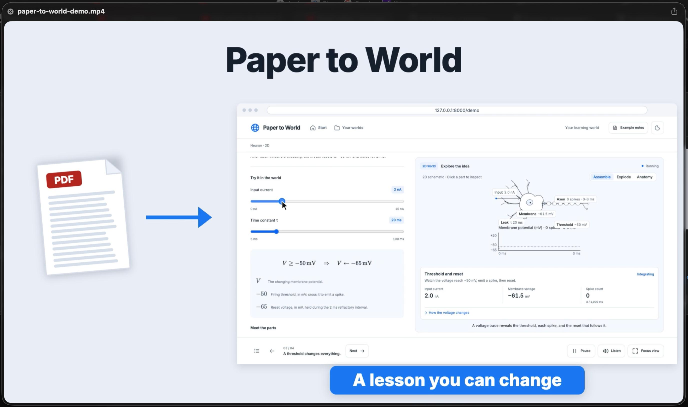
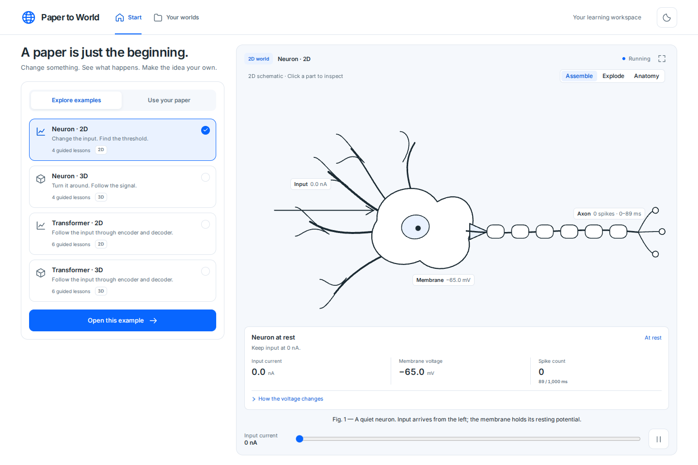
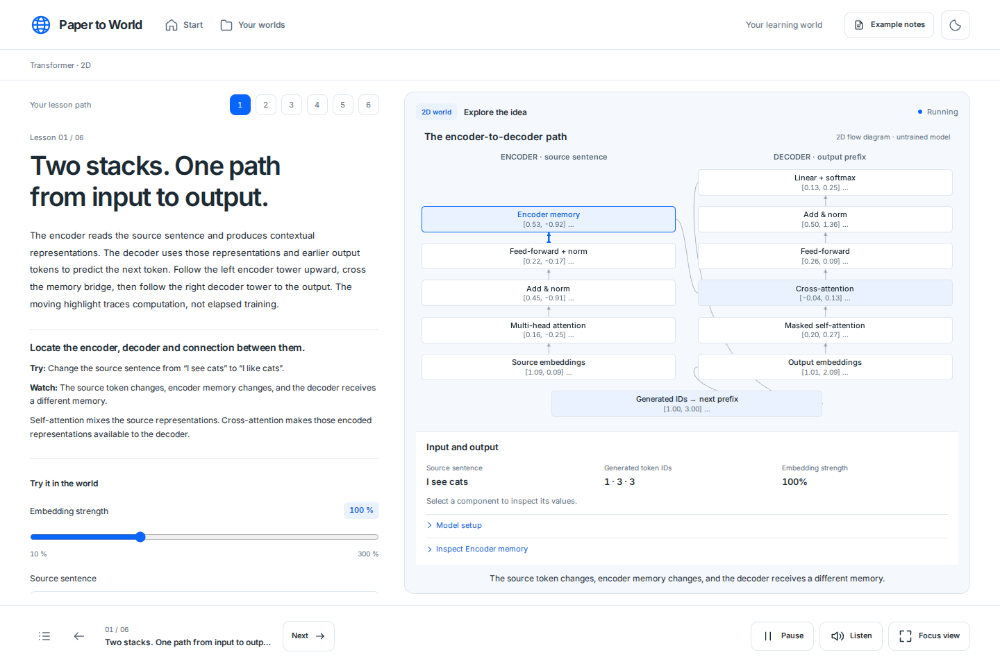
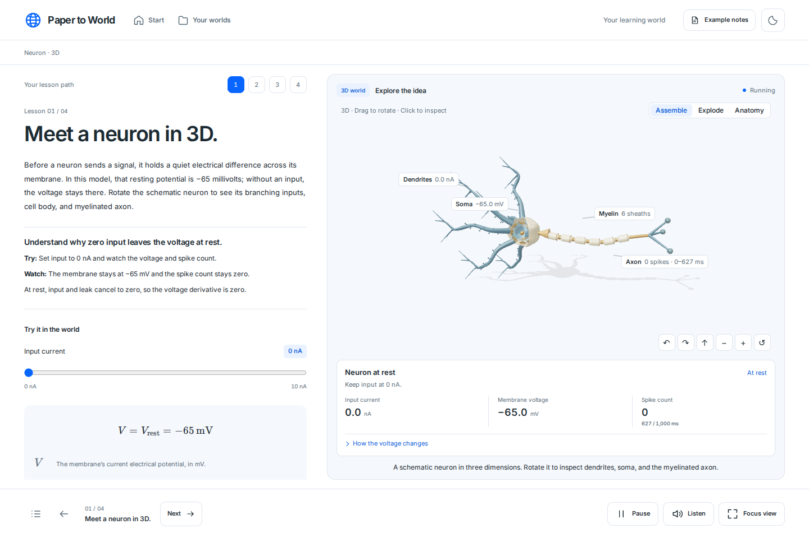

# Paper-to-World

Paper-to-World turns a research paper into an interactive lesson: a short explanation on the left, a live 2D or 3D simulation of the paper's model on the right. Each pipeline stage has contract or evidence checks; publication requires passing planned numerical targets, parity and browser checks. Quotes must appear in the text. The browser simulation must match a Python reference number for number. The world is opened in a headless browser before anyone sees it. Source claims and illustrative teaching assumptions are distinguished. These checks do not prove scientific fidelity.

## Demo video

[](https://youtu.be/aWvklialpLA)

[Watch the demo on YouTube](https://youtu.be/aWvklialpLA).

## Contents

- [Demo preview](#demo-preview)
- [Requirements](#requirements)
- [Quick start](#quick-start)
- [Configuration](#configuration)
- [Using the app](#using-the-app)
- [How it works](#how-it-works)
- [Security model](#security-model)
- [Development](#development)
- [Project layout](#project-layout)
- [Documentation](#documentation)
- [Status and limitations](#status-and-limitations)
- [Credits](#credits)

## Demo preview

Actual screenshots of the app running locally. The prepared examples work without an API key; building a lesson from your own paper requires a configured model.



**Transformer in 2D.** Follow the encoder-to-decoder path from *Attention Is All You Need*. Change the source sentence or embedding strength and inspect the intermediate values in a small untrained model.



**Neuron in 3D.** Rotate the neuron, inspect its anatomy, and change the input current to explore voltage and spiking. This example uses authored teaching notes.



For a short hackathon walkthrough:

1. Start the app using [Quick start](#quick-start), then choose **Explore examples → Transformer · 2D → Open this example**.
2. Change the source sentence, inspect a component, and move through the six guided lessons. Open **Neuron · 3D** to demonstrate rotation, anatomy, and the input-current control.
3. With your model configured, choose **Use your paper**, upload a PDF or enter an arXiv ID, and follow the build progress into the resulting lesson.

## Requirements

| Needed for | Requirement |
|---|---|
| Running the app | Python 3.12+ |
| Building worlds from papers | Node.js 22.13+ (permission model required) (checks the browser simulation against Python) |
| | Chromium for Playwright (opens every generated world before it is published) |
| | Linux 6.7+ with Landlock on x86_64, e.g. Ubuntu 24.04 (confines model-written code without root) |
| | An OpenAI-compatible Chat Completions or Responses model (`LLM_*`) |
| Optional | A model that reads images (`VISION_MODEL`): reads the paper's figures, proofreads equations, transcribes scans, reviews the world |

The prepared examples run with none of the optional parts: no model, no key, no Node.js. Nothing is loaded from the internet: three.js, KaTeX and the Inter font are served by the app itself.

## Quick start

```bash
uv sync --locked
uv run --locked python -m playwright install chromium
cp -n .env.example .env         # set LLM_API_KEY; Meta endpoint/model defaults are included
uv run --locked uvicorn app.main:app --host 127.0.0.1 --port 8000
```

Open http://127.0.0.1:8000. If papers cannot be built on the server (no model configured, no Node.js, or no kernel isolation), the home page says why. The examples still work.

## Production deployment

Use [the deployment guide](docs/deployment.md) for the single-host release configuration, security boundaries, backup and public HTTPS setup.

For a local production-mode run, put `LLM_API_KEY` in `.env` and run:

```bash
scripts/start.sh
```

Meta's endpoint, model and Responses protocol have code defaults. The launcher binds to loopback, uses one worker, enables private browser-session ownership and persistent limits, and installs Chromium if needed. It does not call the provider at startup. Live generated worlds execute inside an opaque sandboxed iframe. Real-provider output still needs your key-based test; host deployment needs your domain and TLS configuration.

## Configuration

All settings are environment variables. A `.env` file in the working directory is read at start-up; `.env.example` documents each one. The same template is available as `.env.sample`; copy either template to `.env` and fill in your own keys. The local `.env` file is excluded from Git.

| Variable | Default | Meaning |
|---|---|---|
| `LLM_BASE_URL`, `LLM_API_KEY`, `LLM_MODEL` | Meta endpoint/model; key required | Text agents; only the key is needed for the supplied Meta configuration |
| `VISION_MODEL` | — | Model for the image agents; `VISION_BASE_URL` and `VISION_API_KEY` default to the `LLM_*` values |
| `LLM_API`, `VISION_API` | chat_completions | Set `LLM_API=responses` for a Responses endpoint; vision inherits it unless overridden |
| `LLM_MAX_TOKENS` | 16000 | Output tokens per reply (the Builder's `world.js` is the longest) |
| `LLM_TIMEOUT` | 600 | Seconds to wait for one reply |
| `PAPER_MAX_CHARS` | 120000 | Paper text per Analyst/Observer call; longer papers are read in parts |
| `PAPER_MAX_UPLOAD_MB` | 50 | Largest accepted PDF |
| `PAPER_MAX_READ_FIGURES` | 12 | Figures the vision model reads (the most mentioned first); all are still cut out and shown |
| `PAPER_MAX_SCANNED_PAGES` | 0 | Pages of a scan to transcribe; 0 means all |
| `PAPER_MAX_WORKERS` | 2 | Papers built at the same time; the rest wait in line |
| `PAPER_MAX_PENDING_RUNS` | 10 | Maximum active plus queued builds; excess uploads/retries receive 503 before a new run is saved |
| `PAPER_MAX_TUTOR_REQUESTS` | 2 | Maximum concurrent live tutor requests; excess requests receive 503 |
| `PAPER_SANDBOX` | auto | `auto`/`landlock`: kernel confinement. `guard`: in-process checks only, for a trusted development machine |
| `PAPER_RUNS_DIR` | runs | Where runs are saved |
| `PAPER_RUN_RETENTION_DAYS` | 7 in production | Delete finished runs older than this, at start-up and hourly; 0 keeps them |
| `PAPER_ENV` | development | `production` enables private sessions and requires positive limits and kernel confinement; an optional entry token must be at least 32 characters |
| `PAPER_ACCESS_TOKEN` | — | Optional entry gate (assets/health stay public); when set, open the app once with `?token=…` (kept in a cookie) or send `Authorization: Bearer …` |
| `PAPER_RATE_LIMIT_PER_HOUR` | 20 in production | Runs, retries, tutor and login attempts per session/IP; persistent across restart; production requires a positive value |

## Using the app

After configuring `.env`, check local prerequisites, then explicitly test the provider:

```bash
uv run --locked python scripts/check_provider.py
uv run --locked python scripts/check_provider.py --live
```

The second command makes billable requests through the application's actual adapter. It checks text JSON and, when `VISION_MODEL` is configured, image input. It prints no key or raw provider error. Without vision configuration, figure reading and visual critique are skipped. A successful probe confirms basic requests, not full-paper quality, quota or total generation cost. `/api/config` reports local prerequisites only.

For an end-to-end real-provider test in the private local workspace:

```bash
uv run --locked python scripts/live_run.py 1706.03762
```

This invokes the live pipeline; prepared examples and their stored tutor answers do not test the provider. Use `LLM_API_KEY` in the app configuration; the standalone Meta tutorial script also accepts its original `MODEL_API_KEY` alias.

**Examples** (home page → *Explore examples*). Each opens a four- or six-lesson world at `/demo`, `/demo/3d` or `/demo/attention/2d` or `/demo/attention/3d`. The demo entry opens the prepared view directly. Development tests can replay its stored answers through the pipeline without a model call.

| Example | View | Source |
|---|---|---|
| How a neuron fires | 2D | Authored teaching notes (`static/demo/paper.pdf`), not a published paper |
| Inside a neuron | 3D | Authored teaching notes (`static/demo3d/paper.pdf`) |
| How the Transformer works | 2D | Attention Is All You Need, Vaswani et al., arXiv:1706.03762 |
| Inside the encoder and decoder | 3D | Same paper; six guided lessons with a small untrained encoder-decoder model |

**Your paper** (home page → *Use your paper*). Upload a PDF or give an arXiv ID.
- `/build/<id>` shows the five steps with details from the paper.
- `/learn/<id>` opens the lesson.
- *Your worlds* (`/worlds`) lists saved runs.
- A failed build can be retried from the stage that failed.

**In a lesson.**
- Predict before the reveal.
- Hover a symbol or term to find it in the world.
- Move sliders and reach the challenge.
- Explore with orbit or pan and zoom.
- Under the figure caption: which shapes come from the paper (with page) and which are illustrative, with links to the paper's own figures.
- *Ask about this paper* opens the tutor.

## How it works

```text
PDF ─► pages (scans: Transcriber*), figure captions, figures cut from rendered pages
   ├─ Analyst ───── analysis.json    concepts, equations, mechanisms, claims, parameters, with pages
   ├─ Proofreader*  analysis.json    each equation checked against an image of its page
   ├─ Viewer* ───── figure readings  box, elements (with boxes), layout, axes
   ├─ Observer ──── evidence.json    how things look; quotes checked in the text, elements in the readings
   ├─ Planner ───── plan.json        one view (2D or 3D), state, update rule, controls, validation targets
   ├─ Modeler ───── model.py         Python reference with run(params, steps); executed in the sandbox
   ├─ Validator ─── validation.json  measured metrics against the paper's claims
   ├─ Porter ────── model.js         browser port; must match model.py in Node
   ├─ Designer ──── scene.json       objects drawn from the paper (with evidence) or labelled hypotheses
   ├─ Writer ────── lessons.json     3–6 lessons over the scene's objects and the model's parameters
   ├─ Builder ───── world.js         draws the scene, imports model.js; opened in headless Chromium
   └─ Critic* ───── critique.json    screenshots against the paper's figures; major issues go back
Tutor: answers from the pages (BM25), the analysis and the figure readings.     * needs VISION_MODEL
```

- **Repairs.** Reference, port, scene, lesson and world checks return the previous answer and exact failure to the generating agent, at most twice. Other contract/publication failures stop the run. The Critic gets two rounds.
- **Checkpoints.** Each stage saves its result in `checkpoints/`, so a retried run continues where it stopped.
- **Learner shell.** The shell (HTML, CSS, JavaScript) is fixed and hand-written; no agent writes HTML.

Failed, partial, missing or nonfinite measurements for required plan targets block publication. Unresolved major visual criticism also blocks publication. Extra source-only benchmarks may remain explicitly `not_measured`.

Details: [docs/visual-workflow.md](docs/visual-workflow.md) (stages and checks) and [docs/builder-contract.md](docs/builder-contract.md) (lesson and world contracts).

## Security model

Generated Python/Node and render checks use kernel confinement. Learner browsers execute generated code in an opaque sandboxed frame, separate from authenticated API access. Production uses private guest-session ownership and optional username/password accounts for every run route and SQLite-backed rate/usage limits. The single-host service template adds cgroup memory/CPU limits and an HTTPS reverse proxy.

See [deployment and threat boundaries](docs/deployment.md) and [current release evidence](docs/public-release-review.md). Prepared examples use stored artifacts and answers; they do not prove provider connectivity or live-generation quality.

## Development

```bash
uv sync --locked
uv run --locked python -m playwright install chromium

scripts/check.sh              # ruff lint, ruff format check, pyright, unit and integration tests (about 4 minutes)
scripts/check.sh --browser    # the same, then every browser script against a server it starts (about 30 minutes)
```

Lint (`ruff`), formatting (`ruff format`) and type checking (`pyright`, standard mode, `app/`, `scripts/` and `tests/` except the browser scripts) are configured in `pyproject.toml`.

**Browser tests.** `tests/run_browser_tests.py [names…]` starts the app on a free port with a temporary runs folder, runs the `tests/browser_*.py` scripts, prints PASS or FAIL for each, and exits non-zero if any fails. Each script can also run on its own against `APP_URL` (default 127.0.0.1:8000).

| Script | Checks |
|---|---|
| `browser_live_path.py` | upload → worker → fake text and vision models over HTTP → 2D and 3D worlds (starts its own servers) |
| `browser_accessibility.py` | axe-core WCAG 2.1 A/AA audit of every page and every example lesson, desktop and phone |
| `browser_build_progress.py` | progress page, cancel, retry (starts its own server) |
| `browser_unified.py` | home, previews, walkthroughs, tutor, theme |
| `browser_living.py` | lesson interactions |
| `browser_neuron3d.py` | 3D example: WebGL, parity, raycast, orbit |
| `browser_museum.py` | 3D assembly, reduced motion |
| `browser_progress_explode.py` | Explode and progress matrix |
| `browser_layout_check.py` | layouts at five widths, light and dark |

**With real inputs.** These are opt-in.

```bash
REAL_PDF_DIR=~/papers .venv/bin/python -m unittest discover -s tests -p test_live_provider.py   # extraction of your PDFs
LIVE_LLM=1 .venv/bin/python -m unittest discover -s tests -p test_live_provider.py             # every stage, configured models
.venv/bin/python scripts/live_run.py 1706.03762          # build one paper in the foreground
.venv/bin/python scripts/evaluate.py 1706.03762 x.pdf    # several papers: readiness, repairs, evidence, Critic issues, tokens, time
```

**Without a key.** `tests/fake_llm_server.py PORT 2d|3d [FIXTURE_DIR]` serves scripted replies over HTTP. With a fixture folder, it serves answers written in advance; that is how the arXiv example was built.

## Project layout

```text
app/         FastAPI app, pipeline, agents, contracts, sandbox, render check (see CODEMAP.md)
static/      hand-written learner shell, home, progress page, the four examples, vendored libraries (vendor/)
tests/       unittest suites, browser scripts and their runner, fixtures, fake model server, axe-core (vendor/)
scripts/     check.sh, live_run.py, evaluate.py, build_demo_notes.py
docs/        workflow, contracts, UI notes, status
runs/        saved runs (not versioned)
```

## Documentation

| Document | Contents |
|---|---|
| [docs/public-release-review.md](docs/public-release-review.md) | Current fixes and verification |
| [docs/deployment.md](docs/deployment.md) | Startup, HTTPS, accounts, limits and backup |
| [docs/production-audit.md](docs/production-audit.md) | Historical audit and prior verification |
| [CODEMAP.md](CODEMAP.md) | File map and layout rules |
| [docs/visual-workflow.md](docs/visual-workflow.md) | Every stage, its inputs, outputs and checks |
| [docs/builder-contract.md](docs/builder-contract.md) | `lessons.json` and `world.js` contracts |
| [docs/upload-progress.md](docs/upload-progress.md) | Progress page and run lifecycle |
| [docs/progress-and-explode.md](docs/progress-and-explode.md) | Shared neuron parts and Explode behaviour of the neuron examples |
| [docs/STATUS.md](docs/STATUS.md) | What is done, what is not, and known limitations |
| [DESIGN.md](DESIGN.md), [PRODUCT.md](PRODUCT.md) | Design direction and product constraints |

## Status and limitations

The workflow is complete and tested with scripted and session-written model answers. It has **not yet run against a live model**, so the prompts' real-world quality is unmeasured. That, the remaining limitations, and the open tasks are listed in [docs/STATUS.md](docs/STATUS.md).

## Credits


Vendored, unmodified, with their licenses next to them: three.js 0.170.0 and two of its addons (MIT, `static/vendor/three`), KaTeX 0.19.1 (MIT, `static/vendor/katex`), Inter (SIL Open Font License 1.1, `static/vendor/inter`), and, for tests only, axe-core 4.10.2 (MPL-2.0, `tests/vendor`).

For Meta Responses configuration and the limits of local verification, see [the API readiness audit](docs/api-readiness-audit.md). The SDK version of the supplied Meta tutorial is [scripts/meta_example.py](scripts/meta_example.py).

Transformer example verification: `.venv/bin/python scripts/check_teaching_examples.py attention2d attention3d` runs the authored stage answers through the full pipeline, including real confined render checks. See [the example report](docs/attention-examples.md).

Teaching quality: [workflow audit and fixes](docs/workflow-audit.md). Reproduce both neuron and Transformer pipelines with `.venv/bin/python scripts/check_teaching_examples.py`.
